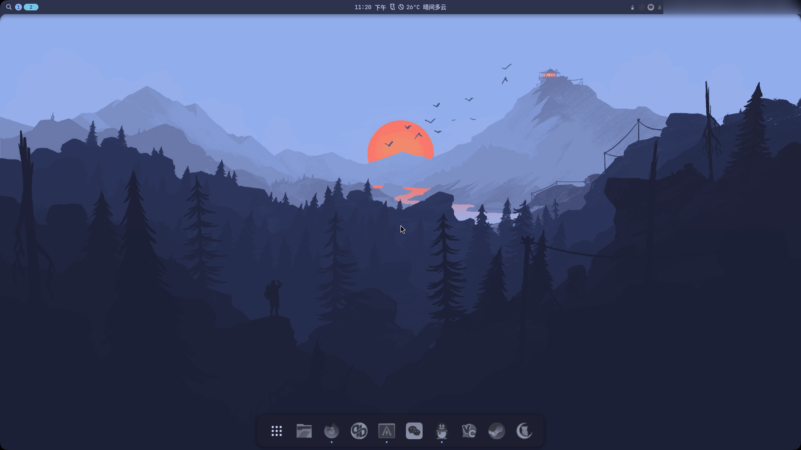

# niri-noctalia-dots

A Niri + Noctalia v5 desktop preset with a Catppuccin-inspired palette, soft corners, a compact top bar, a 12-hour AM/PM clock, and an adaptive dock.

## Preview

| Desktop | Bundled wallpaper |
| :---: | :---: |
|  |  |

The screenshot shows a customized session. Applications, fonts and monitor layout depend on local detection and personal preferences.

## Requirements

- Linux with Niri 25.11+ and Noctalia v5.
- Bash, awk and GNU coreutils (`cmp`, `cp`, `date`, `ln`, `mktemp`, `mv`, `readlink`).
- Recommended: `xdg-utils` for default browser/file-manager discovery, `xdg-user-dirs` for the Pictures directory, and Fontconfig for font detection.
- Optional: Alacritty or another terminal, Fcitx5, and a polkit authentication agent.

The installer deploys user configuration, its wallpaper and a settings launcher. Package installation is handled by your distribution.

## Installation

```bash
git clone https://github.com/vlify/niri-noctalia-dots.git
cd niri-noctalia-dots
./install.sh --check
./install.sh --dry-run
./install.sh --apply
```

`--check` is the default. `--dry-run` prints the detected paths, applications and generated TOML without creating directories or files. `--apply` asks for confirmation; `--apply --yes` explicitly skips that prompt.

Existing Niri, Noctalia and Alacritty config paths are backed up before being linked to the checkout. The generated `zz-adaptive.generated.toml` is local to the checkout and git-ignored. Modified project wallpaper/launcher files are backed up with timestamp suffixes; unrelated user files are preserved. Repeating installation with unchanged inputs leaves existing files and links in place.

## Defaults and adaptation

### Clock

The bar clock and shell time format use `%I:%M %p`, for example `09:05 AM`. The date uses `%m-%d`.

Noctalia's `%p` follows `LC_TIME` ([format reference](https://docs.noctalia.dev/noctalia/configuration/date-format-tokens/)). This repository's Niri startup command launches Noctalia with `LC_TIME=C` and removes an overriding `LC_ALL`, ensuring English AM/PM markers while retaining the system timezone. This affects the Noctalia process and its children rather than the global desktop locale. If you launch Noctalia through another session/service, use the same environment there:

```bash
env -u LC_ALL LC_TIME=C noctalia
```

Changing this environment takes effect on a new Noctalia launch; a config reload alone cannot change an already running process's locale.

### Wallpaper

`assets/wallpaper.png` is bundled in the repository. Installation resolves the Pictures directory using an absolute `XDG_PICTURES_DIR` when provided, then `xdg-user-dir PICTURES`, falling back to `~/Pictures` when unset, invalid, or disabled.

The image is copied to `<Pictures>/wallpaper/niri-noctalia.png`. Missing directories are created only during `--apply`; existing unrelated wallpaper files remain intact. The generated Noctalia configuration sets both the wallpaper directory and its default image path, so a fresh setup can select the bundled image directly.

### Dock

The initial favorites are ordered as:

1. Browser: the valid `xdg-settings` default, then the HTTPS MIME default, then a known installed fallback.
2. Terminal: the executable named by `$TERMINAL`; otherwise the first installed supported terminal, preferring the themed Alacritty. There is no universal default-terminal setting across desktops, so set `$TERMINAL` explicitly to choose another emulator.
3. File manager: the `inode/directory` MIME default, then a known installed fallback.
4. Noctalia Settings: the bundled `niri-noctalia-settings.desktop` launcher.

Desktop entries are checked in XDG application directories and common Flatpak export directories. Hidden or unusable entries are skipped. Missing categories are omitted; Noctalia Settings is always installed. Pin other apps and change the order in Noctalia settings.

### Fonts

Font files are supplied by your distribution or the font upstream. Noctalia prefers an installed JetBrains Mono family, with `sans-serif` as its fallback. Alacritty uses `monospace`, so the desktop remains usable without the suggested fonts. See [字体依赖与回退](docs/fonts.md) for the research references, recommended fonts and commands to inspect/change the selection.

### Displays and existing preferences

Monitor mode, scale and placement are left to Niri's defaults. Add personal output rules for a custom multi-monitor layout.

Noctalia's GUI-managed `~/.local/state/noctalia/settings.toml` takes precedence over the repository files. Installation preserves those preferences; an existing wallpaper, clock or dock override may continue to win. Config validation and a fresh setup must therefore be checked separately from an existing session.

## Keybindings

| Shortcut | Action |
| --- | --- |
| `Alt+Space` / `Mod+Space` | Noctalia application launcher |
| `Mod+Return` | `$TERMINAL` or a supported installed terminal |
| `Mod+Y` | Noctalia clipboard panel |
| `Super+Alt+L` | Noctalia lock screen |
| `Mod+Q` | Close focused window |
| `XF86Audio*` | Noctalia volume/media controls |
| `XF86MonBrightness*` | Noctalia brightness controls |

Noctalia, Fcitx5 and the first available polkit agent are started when available. Remove the Fcitx environment variables from the Niri config when using another input method.

## Validation and recovery

```bash
bash -n install.sh
niri validate -c "${XDG_CONFIG_HOME:-$HOME/.config}/niri/config.kdl"
noctalia config validate "${XDG_CONFIG_HOME:-$HOME/.config}/noctalia"
```

Each replaced configuration path has a `*.bak.<timestamp>` backup. To restore it, move the installed link aside and move the desired backup to its original path. Wallpaper and launcher replacements also receive backups when their content differs.

## License

MIT
